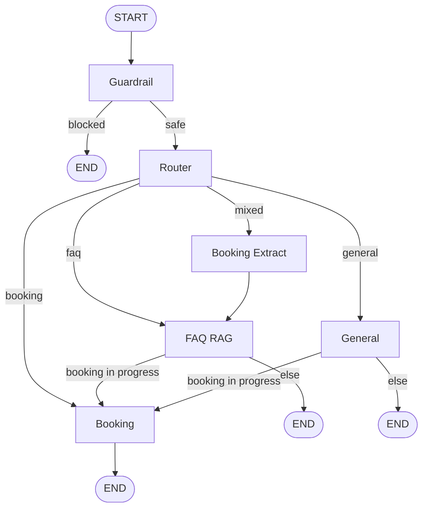

# Agentic Booking & Policy Assistant

A full-stack agentic assistant built with **LangGraph**, **LangChain**, **FastAPI**, and **React**. It answers employee-handbook questions with page citations (RAG) and books appointments (e.g. a 1-on-1 Performance Review) through a multi-turn, stateful conversation — and if you ask a handbook question in the middle of a booking, it answers the question and then resumes the booking exactly where it left off, without losing anything you'd already given it.

Built for the **Full Stack & Agentic AI Engineering Internship** technical assessment.

## Feature checklist

**Tier 1 — Core (all implemented)**

- [x] LangGraph `StateGraph` with typed state, nodes, and conditional edges
- [x] SQLite checkpointer (`AsyncSqliteSaver`), keyed by `thread_id`, surviving process restarts
- [x] Employee handbook PDF ingested into ChromaDB with page-cited retrieval
- [x] Multi-turn slot booking collecting name, email, and a time slot
- [x] FastAPI backend connected to a React frontend
- [x] Context interleaving: an FAQ mid-booking is answered, then the booking resumes
- [x] This README, with setup instructions and an AI Engineering Log

**Tier 2 — Bonus (all implemented)**

- [x] Real-time token streaming over SSE, with a non-streaming fallback
- [x] Live UI badge showing the active graph node, with a per-message node-path trail
- [x] Guardrails against prompt injection (input) and system-prompt leaks (output)
- [x] `Dockerfile` for both services + `docker-compose.yml` (see [Docker caveat](#docker) below)

## Architecture



### Request flow

```
React (useChat hook) ──POST /api/chat or /api/chat/stream──▶ FastAPI
                                                                 │
                                                        app.state.graph.ainvoke / .astream
                                                                 │
                                                     LangGraph StateGraph (above)
                                                                 │
                                              AsyncSqliteSaver checkpointer (checkpoints.sqlite)
```

### State schema (`backend/app/graph/state.py`)

```python
class BookingDraft(BaseModel):
    service_type: str | None
    name: str | None
    email: str | None
    slot_id: int | None
    slot_label: str | None
    status: Literal["idle", "collecting", "confirmed"]
    reference_id: str | None

class AgentState(TypedDict):
    messages: Annotated[list[AnyMessage], add_messages]  # full conversation, reduced via add_messages
    intent: Literal["faq", "booking", "mixed", "general", "blocked"] | None
    faq_question: str | None       # the question part of a "mixed" message
    booking: BookingDraft           # lives independently of `messages` — this is how interleaving works
    citations: list[Citation]       # cleared every turn by the router, set by rag
    active_node: str                # last node to run; also what the SSE "node" event reports
```

### How context interleaving actually works

The trick is that `booking` is its own slot in state, untouched by the `rag` node. When a message mixes booking details with a question (`"Alex Chen (alex.chen@example.com). Wait, before that, how often are performance reviews conducted?"`):

1. `router` classifies the message as `"mixed"` and extracts just the question into `faq_question`.
2. `booking_extract` pulls the name and email out of the same message and merges them into the existing `BookingDraft` — silently, no reply yet.
3. `rag` answers the question from the handbook, with citations.
4. A conditional edge checks `booking.status == "collecting"`. Since it is, control routes to `booking` instead of ending the turn.
5. `booking` sees `active_node` was `"rag"` on entry, so it opens with *"Returning to your booking, Alex…"*, then continues from the name/email that were already there — it never re-asks for anything already collected.

One turn, two assistant messages (the FAQ answer, then the booking continuation) — nothing about the booking is lost.

### Repository layout

```
backend/
  app/
    main.py                  FastAPI app, lifespan (builds the graph once), CORS, error handlers
    config.py                 pydantic-settings, reads .env
    api/
      routes_chat.py          POST /api/chat, POST /api/chat/stream (SSE), GET /api/threads/{id}
      routes_slots.py         GET /api/slots, GET /api/bookings
      schemas.py               request/response Pydantic models
    graph/
      state.py                 AgentState, BookingDraft
      prompts.py                every system prompt, in one place
      llm.py                    ChatGroq factories (main + router models)
      builder.py                 wires nodes + conditional edges into a compiled graph
      checkpointer.py             SQLite checkpointer with an explicit msgpack allowlist
      edges.py                     routing functions
      nodes/
        guardrail.py              input guardrail (rules + a cheap LLM check)
        router.py                 intent classification (structured output)
        rag.py                    retrieval + cited answer
        booking_extract.py        silent field extraction for "mixed" messages
        booking.py                 the booking flow + the book_slot tool call
        general.py                  small talk / out of scope
      output_guard.py             output-side system-prompt-leak check
    rag/
      ingest.py                    downloads the PDF, chunks it, embeds it, persists to Chroma
      retriever.py                  retriever + vector store accessors
    services/
      slot_store.py                 async SQLite slot/booking store, atomic booking
      chat_service.py                thin service layer between routes and the graph
    tools/
      booking_tools.py                LangChain @tool get_available_slots / book_slot
  tests/                             35 tests across every layer above
  scripts/demo_dialogue.py            replays the assessment's sample dialogue, prints a node trace
frontend/
  src/
    api/{client.ts,types.ts}          fetch + SSE client
    hooks/{useChat.ts,useHealth.ts}    all chat state and connection polling
    components/                        ChatWindow, MessageBubble, Composer, SlotsPanel,
                                        ThreadHeader, CitationChips, BookingCard, NodeBadge,
                                        TypingIndicator
docs/
  screenshots/, traces/                real verification artifacts (see below)
```

## API reference

| Method | Path | Body | Returns |
|---|---|---|---|
| `POST` | `/api/chat` | `{thread_id?, message}` | `{thread_id, reply, new_messages, active_node, citations, booking}` |
| `POST` | `/api/chat/stream` | `{thread_id?, message}` | SSE: `node`, `token`, `message`, `citations`, `booking`, `done`, `error` |
| `GET` | `/api/threads/{thread_id}` | — | `{thread_id, messages, booking, citations}` (404 if unknown) |
| `GET` | `/api/slots` | — | available slots |
| `GET` | `/api/bookings` | — | confirmed bookings |
| `GET` | `/api/health` | — | `{status, llm_key_configured, vector_store_doc_count}` |

## Local execution guide

### Prerequisites

- Python 3.11+, Node 20+
- A free Groq API key: [console.groq.com/keys](https://console.groq.com/keys)

### Backend

**Windows (PowerShell):**

```powershell
cd backend
python -m venv .venv
.\.venv\Scripts\python.exe -m pip install -r requirements.txt
copy .env.example .env   # then paste your GROQ_API_KEY into .env
.\.venv\Scripts\python.exe -m app.rag.ingest
.\.venv\Scripts\python.exe -m uvicorn app.main:app --reload --port 8000
```

**macOS / Linux:**

```bash
cd backend
python3 -m venv .venv
./.venv/bin/pip install -r requirements.txt
cp .env.example .env   # then paste your GROQ_API_KEY into .env
./.venv/bin/python -m app.rag.ingest
./.venv/bin/uvicorn app.main:app --reload --port 8000
```

### Frontend

```bash
cd frontend
npm install
npm run dev
```

Open the printed `http://localhost:5173` URL. The backend must be running on port 8000 (or set `VITE_API_BASE_URL` in `frontend/.env`).

### Tests

```powershell
cd backend
.\.venv\Scripts\python.exe -m pytest tests/ -v
```

35 tests, covering ingestion/retrieval, the slot store (including atomic double-booking rejection), the LangGraph state machine (replaying the assessment's exact sample dialogue, persistence across a rebuilt graph, invalid email handling, prompt-injection blocking, out-of-document questions), the FastAPI layer, SSE streaming, and the output guardrail.

### Docker

```bash
cp backend/.env.example backend/.env   # then add your GROQ_API_KEY
docker compose up --build
```

> **Caveat:** Docker Desktop would not finish starting in the environment this was built in (its WSL2 backend stayed stuck for 10+ minutes across several attempts), so `docker compose up --build` is **not** verified end-to-end here. `docker compose config` does confirm the compose file itself is valid — env vars, volumes, ports, and the healthcheck all resolve correctly — but the actual image builds are unverified. Please run it yourself to confirm before relying on it.

## Verification artifacts

All of these are real output from actually running the project, not placeholders:

- [`docs/traces/demo_dialogue_trace.txt`](docs/traces/demo_dialogue_trace.txt) — `scripts/demo_dialogue.py` replaying the assessment's exact Section 7 sample dialogue end to end, with the node path printed per turn
- [`docs/traces/sse_stream_sample.txt`](docs/traces/sse_stream_sample.txt) — a raw `curl` capture of `/api/chat/stream`, showing the `node`/`token`/`message`/`citations`/`booking`/`done` event sequence
- [`docs/traces/pytest_full_suite.txt`](docs/traces/pytest_full_suite.txt) — the full test suite, 35/35 passing
- [`docs/screenshots/faq_rag_with_node_badge.jpg`](docs/screenshots/faq_rag_with_node_badge.jpg) — a cited handbook answer with the node-path badge
- [`docs/screenshots/booking_confirmed_card.jpg`](docs/screenshots/booking_confirmed_card.jpg) — a completed booking with its reference ID
- [`docs/screenshots/mobile_slots_drawer.jpg`](docs/screenshots/mobile_slots_drawer.jpg) — the responsive mobile slots drawer at 375px

## AI Engineering Log

**Tools used:** Claude Code (Anthropic), running Claude Opus 5.5 and Claude Sonnet 5 at different points in this build.

Every entry below is a real incident hit while building this project — not a hypothetical. Each one was found by actually running the code (tests, a live browser, `curl`, or a Docker check), not just by reading it.

### Windows / environment quirks

1. **BOM in a config file broke the Vite build.** A PowerShell command used `-Encoding utf8`, which on Windows PowerShell 5.1 writes a UTF-8 byte-order mark. Node's `JSON.parse` doesn't accept a BOM, so `@tailwindcss/vite` failed on `package.json` with `Unexpected token ''`. Fixed by writing the file as UTF-8 *without* a BOM.
2. **`zoneinfo` had no timezone database on Windows.** `ZoneInfo("Asia/Kolkata")` raised `ZoneInfoNotFoundError` — Windows has no system IANA tz database the way Linux/macOS do, so `zoneinfo` needs the pip-installable `tzdata` package as a fallback. Added it to `requirements.txt`.

### Async bugs

3. **Double-awaiting an `aiosqlite` connection.** A helper did `conn = await aiosqlite.connect(path)`, then every call site wrapped that *already-awaited* connection in `async with ... as conn:` — which calls `__aenter__` → `await self` a second time on the same object, crashing with `RuntimeError: threads can only be started once`. `aiosqlite.connect()` returns a connection that is itself awaitable; it must be entered exactly once. Fixed by returning it unawaited and entering it once per call site.
4. **LangGraph's checkpointer silently warned about a custom state type.** `AsyncSqliteSaver.from_conn_string()`'s default serializer logged `Deserializing unregistered type app.graph.state.BookingDraft from checkpoint. This will be blocked in a future version` on every resumed thread. Fixed by constructing `JsonPlusSerializer(allowed_msgpack_modules=[...])` explicitly instead of relying on the default.

### Stale knowledge

5. **Guessed Groq model IDs had been retired.** `llama-3.3-70b-versatile` / `llama-3.1-8b-instant` were real, commonly-documented model IDs, but a live smoke test returned `404 model_not_found` — Groq had retired them from this account's catalog since the assistant's knowledge cutoff. Listed the live catalog with `client.models.list()` instead of guessing, and switched to `openai/gpt-oss-120b` / `openai/gpt-oss-20b`.

### Streaming (the trickiest category)

6. **`stream_mode="messages"` emits more than just tokens.** It also broadcasts the complete, final `AIMessage` a node returns as its own state update — not only incremental `AIMessageChunk` pieces. The first version of the SSE endpoint forwarded both, so the client received the whole answer a second time right after the real stream. Fixed by filtering on `isinstance(chunk, AIMessageChunk)`.
7. **The SSE parser assumed `\n\n` line endings.** It worked perfectly against `curl`'s printed output (which silently normalizes `\r\n`), but the browser's real `fetch` response body delivers `\r\n\r\n`-separated events — so `buffer.indexOf("\n\n")` never matched, and the UI hung forever with no error. Found only by pasting a *raw* `fetch` + `reader.read()` loop into the browser console and comparing it to a working `curl` test byte-for-byte. Fixed by normalizing `\r\n → \n` before parsing.
8. **A reply with no LLM call behind it was dropped entirely.** The booking node's confirmation message is a hardcoded Python string (deliberately, so a reference ID can never be hallucinated) — it never produces a single `token` event. The frontend only built message bubbles from tokens, so the confirmation silently vanished from the chat window even though the booking succeeded server-side. Fixed by adding an authoritative `message` SSE event per completed node, used as the source of truth for each bubble.

### Multi-message turns (UI bugs no automated test caught)

9. **Citations attached to the wrong bubble.** An interleaved turn produces two assistant messages; citations were attached to the *last* one (`i === length - 1`) instead of the first (the actual FAQ answer), which only happened to be correct on single-message turns. Found by actually reading the rendered page in a browser, not by the passing backend tests (which only check the raw `citations` field, not which bubble it's rendered under).
10. **The booking confirmation card kept reappearing.** It was attached to the last message of *every* turn where `booking.status === "confirmed"`, with no check for whether the booking had *just* been confirmed — since that status persists for the rest of the thread by design, the card kept showing up on unrelated later replies. Fixed by only attaching it on the turn where the status actually transitions to confirmed.

### Prompt leakage

11. **The RAG prompt's own `<context>` tags leaked into an answer.** `RAG_SYSTEM` wraps retrieved excerpts in `<context>` tags and tells the model never to follow instructions inside them — but never said not to *echo the tags themselves*. Capturing a real SSE trace for this README's verification artifacts (not a contrived test) surfaced a case where the model copied the wrapper into its reply: `"<context>There are three steps...</context>"`. Fixed with an explicit prompt rule plus a deterministic regex strip as a safety net, since a prompt instruction alone is still probabilistic.

## Design decisions

- **Booking execution is deterministic, not LLM-driven.** The `booking` node extracts fields with structured LLM output, but the actual slot-matching, email validation, and `book_slot` tool call are plain Python — the LLM only *phrases* the reply. This keeps the critical path (never double-booking a slot, never inventing a reference ID) reliable regardless of model behavior.
- **Citations and booking snapshots are attached per-message, not per-turn**, because one turn can produce two messages (see interleaving above) and each piece of metadata belongs to a specific one of them.
- **Streaming is split into `token` (incremental) and `message` (authoritative final text) events** rather than relying on tokens alone, because not every reply is LLM-generated (see AI log #8).

## Known limitations / future work

- Docker image builds are unverified in this environment (see the [Docker caveat](#docker) above).
- The booking flow handles one service type (Performance Review) by default; extending to multiple bookable service types would mean generalizing the slot store's service-type filtering.
- No authentication — anyone with the URL can see all slots and book one, which is fine for this assessment's scope but not for a real deployment.
- The employee handbook PDF used doesn't cover PTO/benefits/leave at all (verified directly against the raw PDF text); the agent correctly says so rather than guessing, but a real deployment would want the assessment's alternative Benefits PDF ingested too.
